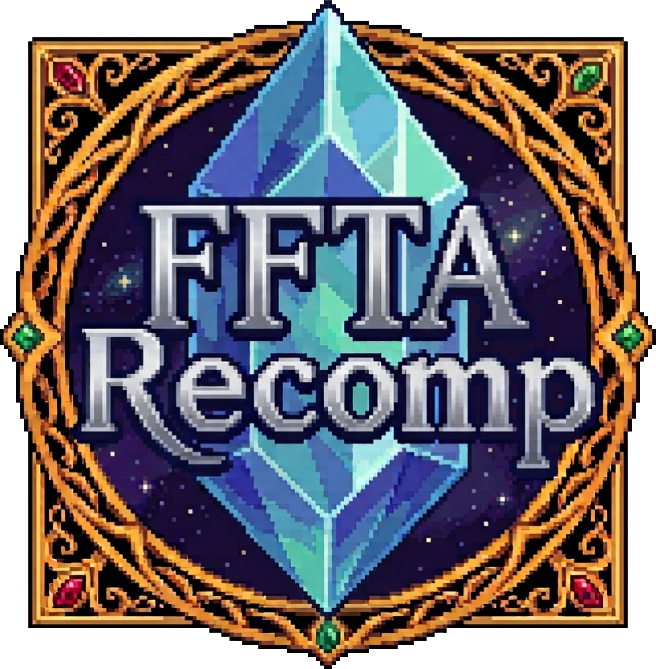

  

<h1 align="center">FFTARecomp</h1>

  <b>Final Fantasy Tactics Advance, running natively on your Windows PC.</b> 
  Widescreen, video and audio options, and a one-click installer.

  
  
  

---

## ✨ What is this?

**FFTARecomp** turns *Final Fantasy Tactics Advance* (USA version) into a native Windows program. Instead of running in an emulator, the game is recompiled from your own ROM, so it runs smoothly, needs no BIOS, and gets modern options. It is based on [gba-recomp](https://github.com/JRickey/gba-recomp) by JRickey.

## 🎮 Features

- 🖥️ **Widescreen:** Auto, 16:10, 16:9 (default), 20:9, 21:9 and experimental 32:9.
- 🎨 **Video options:** screen model, grid, scaling and vsync.
- 🔊 **Audio options** and volume control.
- ⏩ **Fast forward.**
- 🕹️ **Remappable controls.**
- 📦 **One-click installer:** pick your ROM and you're done.
- 🚫 **No console BIOS needed.**

## 🚀 Installation

1. Download `FFTARecomp.rar` from [Releases](https://github.com/Jorge262007/FFTARecomp/releases) and extract it.
2. Run `FFTARecomp.exe`, choose your ROM and press **Recompile & Install**.
3. Wait for the five steps to finish, then press **Play**. ▶️

> 💡 You need your own copy of *Final Fantasy Tactics Advance (USA)*. This project does not include any game data.

## ⚠️ Good to know

- 🐢 The first installation builds the game on your PC and can take several minutes. It is normal for the PC to slow down and for CPU/RAM usage to rise. This only happens once.
- 💾 The install is larger than the game alone because it includes the compiler toolchain needed to build it.
- 🐛 This is a work in progress. If you find a bug, please open an [issue](https://github.com/Jorge262007/FFTARecomp/issues) and tell us what happened and your PC specs.

> ### 🛡️ Windows or your antivirus shows a warning?
> **The executables are not code-signed**, so Windows SmartScreen or your antivirus may show a warning. Click **More info → Run anyway**, or right-click the `.rar` → Properties → tick **Unblock** before extracting.
>
> If you have any doubts, you can check the **VirusTotal report** included in each release.

## 📜 License and credits

- License: see [LICENSE](LICENSE). It keeps the original author's copyright line.
- Based on [gba-recomp](https://github.com/JRickey/gba-recomp) (MIT OR Apache-2.0).
- Includes w64devkit/GCC, with their licenses in `payload/toolchain`.
- *Final Fantasy Tactics Advance* is owned by Square Enix / Nintendo. This project is not affiliated with them and does not distribute ROMs or copyrighted game data.

---

Made by a fan, for fans.

