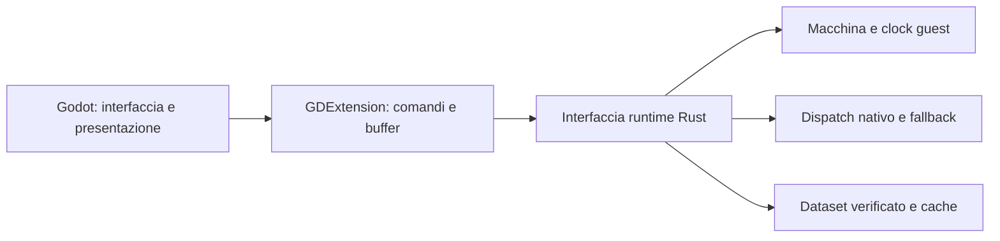

# Valutazione e TODO — frontend Godot 4

Aggiornato il 26 ottobre 2026. **Solo pianificazione; sviluppo rinviato.**
La priorità resta terminare l'estrazione della ROM e il relativo consumo dei
dati nel runtime. Questo documento non autorizza build, installazioni, refactor
o prototipi. La bozza iniziale di codice è stata rimossa su richiesta utente.

## Valutazione

Godot è un candidato ragionevole per finestra, menu, navigazione con controller,
layout e presentazione. Rust dovrebbe continuare a gestire CPU, memoria,
clock guest, ricompilazione, dati estratti e salvataggi. Cambiare il frontend
non richiede riscrivere il gioco come scene Godot né importare nuovamente tutti
gli asset estratti attraverso un secondo decoder.

Il vantaggio atteso è la facilità di sviluppo dell'interfaccia. Non è ancora
dimostrato un vantaggio di velocità o latenza rispetto al frontend attuale.
I costi da valutare saranno trasferimento dei frame, sincronizzazione audio,
gestione dell'input e distribuzione dell'engine insieme all'estensione.

La raccomandazione è **finire prima il lavoro ROM, poi valutare una prova
circoscritta**, senza impegnarsi ora in una migrazione completa.

## Situazione del codice

- [Machine](../../crates/gba-core/src/machine.rs) è già un'interfaccia di
  libreria utilizzabile per esecuzione interpretata e stato della macchina.
- [recomp-core](../../crates/recomp-core/src/lib.rs) espone analisi e
  compilazione; questo non equivale a esporre tutto il runtime di gioco.
- Il dispatch misto nativo/interprete è ancora una funzione privata in
  [main.rs](../../crates/recomp/src/main.rs), richiamata dal ciclo di
  [play.rs](../../crates/recomp/src/play.rs). Quest'ultimo coordina anche input,
  audio, presentazione, pause e scrittura della memoria cartuccia.
- Preparazione e caricamento del dataset sono nel modulo dell'applicazione
  [rom_data.rs](../../crates/recomp/src/rom_data.rs). Il futuro frontend deve
  riutilizzarne identità, controlli e owner immutabili.
- Gli [snapshot core](../../crates/gba-core/src/save_state.rs) sono distinti
  dagli [slot desktop](../../crates/recomp/src/save_state.rs), che aggiungono
  anteprima, scritture atomiche e Undo. Collegare soltanto Machine non porta
  automaticamente queste funzioni in Godot.

Quindi una prova con interprete è possibile senza rifare l'architettura nativa.
Un frontend che mantenga anche la ricompilazione e tutte le funzioni desktop
richiede prima un confine runtime riutilizzabile. Questo è il requisito
architetturale principale, non una limitazione di GDExtension.

## Prerequisiti e ordine

### GD-00 — Valutazione preliminare

- [x] Individuare il core riutilizzabile e le parti ancora legate all'eseguibile.
- [x] Distinguere prova del collegamento e sostituzione completa del frontend.
- [x] Registrare il rinvio ed eliminare lo scheletro di implementazione iniziato.

### GD-01 — Concludere il lavoro ROM prima dello sviluppo Godot

- [ ] Chiudere l'ambito EUR concordato di inventario, estrazione/decodifica,
  preparazione, consumo diretto e verifica: [ROM_DATA_TODO](ROM_DATA_TODO.md).
- [ ] Fissare una baseline riproducibile: revisione del codice, identità ROM,
  manifest/versione del dataset e prove funzionali accettate.
- [ ] Dichiarare risorse o lingue ancora aperte e dipendenze residue dalla ROM;
  la percentuale della mappa non è da sola un criterio di completamento.
- [ ] Selezionare esplicitamente in futuro il lavoro Godot. La chiusura di un
  incremento ROM non deve far partire automaticamente questo TODO.

Le mod, l'eliminazione completa della `.gba`, la conclusione di ogni caso DS,
Android e la parità USA non sono requisiti tecnici per una prima prova EUR.
Il loro eventuale inserimento nella fase preliminare richiede una scelta di
ambito; non vanno aggiunti automaticamente come blocchi.

### GD-02 — Definire l'interfaccia runtime

- [ ] Decidere cosa deve dimostrare il primo prototipo: comunicazione con
  Machine oppure anche esecuzione nativa. Il risultato di un prototipo solo
  interprete non permette conclusioni sulle prestazioni del percorso nativo.
- [ ] Definire creazione/distruzione, caricamento ROM/dataset, avanzamento di
  un frame completo, input, video, audio, pause, reset ed errori.
- [ ] Per includere il nativo, pianificare una libreria headless condivisa che
  riusi dispatch, cache e fallback esistenti. Evitare una seconda copia del
  dispatcher mantenuta separatamente nel plugin.
- [ ] Trattare tale separazione come intervento distinto e successivo al lavoro
  ROM. Non sostituire l'eseguibile normale durante lo studio; eventuali refactor
  del frontend esistente richiedono una fase propria con verifica di equivalenza.

Proposta di responsabilità, ancora da implementare:

### GD-03 — Concordare i contratti prima del prototipo

- [ ] **Tempo e input:** Rust conserva il clock guest. Il refresh Godot non
  deve trasformare una sequenza identica di input in un'esecuzione diversa.
  Definire pausa, perdita del focus e rilascio dei pulsanti.
- [ ] **Video:** scegliere un frame classico 240×160 per la prima prova.
  Censire separatamente widescreen, HUD/UI nativa e filtri attuali: una texture
  classica non ne dimostra la parità. Stabilire formato, dimensioni e durata
  dei buffer senza far leggere a Godot puntatori Rust non più validi.
- [ ] **Audio:** definire frequenza effettiva dei campioni, canali, coda
  limitata, sincronizzazione, pausa e svuotamento dopo Load/reset. Valutare
  l'invio in blocco tramite GDExtension ad AudioStreamGenerator.
- [ ] **Dati:** mantenere in Rust manifest, hash, dipendenze e lettura delle
  risorse tipizzate; nessuna seconda estrazione o interpretazione autonoma in
  GDScript. Le cache native restano legate a ROM e ABI corrette.
- [ ] **Persistenza:** riutilizzare formato e validazioni di snapshot e SRAM.
  Definire ripristino delle code e del contesto nativo, anteprime e Undo;
  lavorare inizialmente solo con copie e cartelle del prototipo.
- [ ] **Ciclo di vita:** assegnare un proprietario al runtime e ai buffer,
  definire chiusura delle code/thread e caricamento/scaricamento delle librerie.
  Non introdurre hot reload dell'estensione nella prima prova.

### GD-04 — Predisporre l'isolamento, quando lo sviluppo sarà selezionato

- [ ] Scegliere una coppia Godot/godot-rust supportata e versionata; ricontrollare
  la compatibilità al momento dello sviluppo.
- [ ] Usare progetto e workspace Cargo separati, lockfile e directory di build
  propri; congelare il runtime su una revisione concordata.
- [ ] Non usare i target, cache, percorsi di salvataggio o Wine prefix della
  produzione e dell'estrazione. Escludere dati di gioco e binari generati da Git.
- [ ] Preparare una procedura Windows riproducibile. Docker è un'opzione per
  le dipendenze di compilazione; la distribuzione del progetto Godot va valutata
  separatamente. Nessuna modifica ai normali comandi di estrazione o packaging.

### GD-05 — Prova minima futura e criterio di decisione

- [ ] Verificare caricamento reale della GDExtension e avvio/chiusura puliti.
- [ ] Provare ROM, input, frame classico, audio, pausa e caricamento di uno
  snapshot in una cartella di lavoro separata.
- [ ] Confrontare sequenze identiche fra runtime headless e bridge: stato,
  clock guest, immagini e audio; controllare gli errori senza perdere il gioco
  già caricato. Riutilizzare i punti ordinari accettati appropriati.
- [ ] Se è previsto il nativo, verificare anche cache, fallback, Load/reset e
  dataset, oltre al semplice avvio del core interprete.
- [ ] Solo dopo queste prove decidere se il vantaggio per l'interfaccia
  giustifica integrazione completa, packaging e porting delle funzioni avanzate.

Widescreen/HUD completi, controller fisici, Linux e altre piattaforme,
integrazione completa di backup/Undo e misure di prestazioni sono criteri di
adozione successivi. Restano espliciti e non diventano prove già superate con
il solo collegamento della libreria. Nessun benchmark è previsto ora.

## Riferimenti tecnici

- [Compatibilità godot-rust e versioni API/runtime](https://godot-rust.github.io/book/toolchain/compatibility.html).
- [AudioStreamGenerator](https://docs.godotengine.org/en/stable/classes/class_audiostreamgenerator.html): frequenza del flusso e invio audio da codice compilato.
- [Thread-safe APIs](https://docs.godotengine.org/en/stable/tutorials/performance/thread_safe_apis.html): gestione del scene tree e delle risorse Godot.
